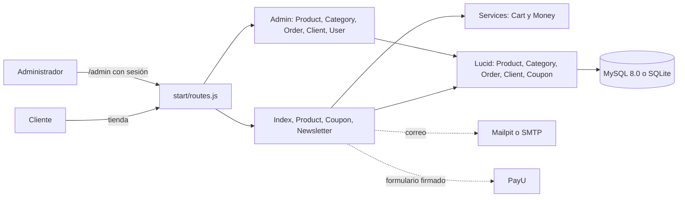

# Tienda en línea de moda y lencería con backoffice (AdonisJS)

[](https://github.com/KevinAndrey96/adonisjs-fashion-boutique-ecommerce-platform/actions/workflows/ci.yml)


Tienda en línea para una boutique colombiana de ropa femenina, lencería y accesorios, con su backoffice de inventario y pedidos. Se construyó en 2020 con AdonisJS 4, Edge y Lucid; los clientes compran sin crear cuenta y pagan contraentrega o con PayU.

## Funcionalidades

**Tienda**

- Portada con colecciones (bodys, panties, brasieres, lencería y accesorios), categorías y detalle de producto con relacionados.
- Búsqueda por nombre y categoría, filtros por rango de precio y orden por precio o nombre.
- Carrito en el navegador. El checkout recalcula cada línea con el precio de la base de datos, nunca con el que envía el navegador, y limita las cantidades a 1..20.
- Pago contraentrega o con el formulario web de PayU, firmado con MD5 según su especificación y activado solo con `ENABLE_PAYU=true`.
- Cupones de descuento de un solo uso, boletín que envía un cupón de bienvenida y correo de confirmación del pedido.

**Backoffice** (`/admin`, con sesión)

- Productos y categorías con imagen; solo se aceptan PNG, JPG o GIF de hasta 10 MB, guardadas con nombre fijo por id.
- Pedidos con detalle de productos y cliente, y listado de clientes.
- Los visitantes sin sesión se redirigen al login, y todos los formularios llevan token CSRF (Shield).

## Arquitectura



- `app/Services/Cart.js` interpreta el carrito y lo resuelve contra el catálogo.
- `app/Services/Money.js` formatea pesos colombianos para todas las vistas.
- `app/Exceptions/Handler.js` redirige al login cuando falta la sesión en el backoffice.

## Puesta en marcha

### Local con SQLite

```bash
npm ci --legacy-peer-deps
cp .env.example .env
node ace key:generate
node ace migration:run
node ace seed
npm run dev        # http://127.0.0.1:3333
```

### Docker Compose (MySQL y Mailpit)

```bash
export APP_KEY=$(openssl rand -hex 16)
docker compose up -d --build
docker compose exec app node ace migration:run --force
docker compose exec app node ace seed --force
```

- Tienda: http://localhost:3333
- Mailpit: http://localhost:8025

La imagen corre como el usuario `node`, sin privilegios, y tiene healthcheck. El compose exige `APP_KEY`: no trae una clave por defecto.

### Datos de demostración

El seeder crea categorías, productos, un cupón y el usuario `admin@example.com` con la contraseña `BoutiqueAdmin2026!`, solo para el entorno local.

## Calidad

```bash
npm run lint   # ESLint
npm test       # pruebas HTTP con node:test
```

Las pruebas levantan el servidor real sobre la base SQLite sembrada y revisan:

- que las páginas de la tienda carguen;
- los endpoints JSON del carrito;
- los 404;
- la redirección del backoffice al login;
- el rechazo de un POST sin token CSRF;
- una compra completa con token CSRF, que confirma que el pedido usa el precio de la base, limita la cantidad e ignora productos inexistentes.

El CI corre lint y pruebas en Node 18, 20 y 22, construye la imagen Docker y espera a que el contenedor quede saludable.

## Historia

Proyecto de 2020 y 2021 para una boutique de Bogotá. En noviembre de 2026 se ordenó sin cambiar el stack:

- el servidor ya no intenta leer certificados inexistentes al arrancar (fallaba con ENOENT);
- PayU queda apagado de verdad cuando `ENABLE_PAYU` no es `true` (antes la cadena `"false"` lo activaba);
- las cantidades negativas o enormes ya no alteran el total;
- los correos que fallan quedan registrados en el log en lugar de silenciarse;
- la lógica repetida de carrito y moneda pasó a dos servicios;
- se eliminaron dependencias sin uso;
- el lockfile se regeneró, la imagen Docker corre sin root y se agregaron ESLint, pruebas y CI.

Las credenciales que alguna vez estuvieron en el código se purgaron del historial.

## Licencia

Sin licencia de código abierto. El proyecto nació como trabajo para un cliente y se publica como muestra de portafolio: todos los derechos reservados.
