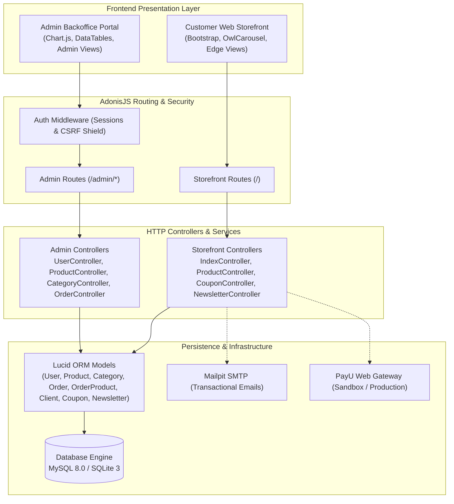

# 👗 Fashion Boutique E-Commerce Platform & Backoffice System

[](https://github.com/KevinAndrey96/fashion-boutique-ecommerce-platform/actions/workflows/ci.yml)
[](https://nodejs.org/)
[](https://adonisjs.com/)
[](https://www.mysql.com/)
[](https://www.docker.com/)
[](LICENSE)

A full-stack e-commerce platform and inventory management backoffice for women's fashion, apparel, and lingerie, built with **Node.js**, **AdonisJS**, **Lucid ORM**, **Edge Templates**, and **MySQL/SQLite**.

---

## 🏛️ Architecture Overview

The platform unifies a customer-facing fashion storefront and an administrative backoffice into a modular monorepo:



---

## ✨ Features

### 🛍️ Customer Storefront (`/`)
- **Responsive Boutique Catalog:** Elegant showcase for dresses, bodys, lingerie, and accessories with dynamic carousels.
- **Search & Filter:** Instant search by product name, price brackets, and category hierarchies.
- **Coupons & Promotions Engine:** Real-time coupon code validation with automatic percentage discounts on cart totals.
- **Newsletter Subscription:** Automated customer onboarding that creates a unique 10% welcome coupon and sends notification emails.
- **Shopping Cart & Checkout:** Persistent client-side cart, customer profile auto-resolution, cash on delivery, and PayU integration.

### 📊 Admin Backoffice (`/admin`)
- **Secured Authentication:** Protected administrative routes with bcrypt password hashing.
- **Analytics Dashboard:** Performance cards (visits, orders, newsletter subscribers, conversion rate) and sales trend charts.
- **Product Inventory Management:** Full CRUD with multipart image uploads, category assignment, SKUs, and price formatting.
- **Category Hierarchy:** Manage root categories and nested sub-classifications.
- **Order & Invoice Tracking:** Real-time visibility into customer orders, line items, applied coupons, and dispatch status.
- **Customer CRM:** Centralized client directory with contact and delivery details.

---

## 🚀 Quickstart

### Option 1: Docker Compose (Recommended)

Run the full stack (Application, MySQL 8.0, and Mailpit) in seconds:

```bash
# 1. Clone the repository
git clone git@github.com:KevinAndrey96/fashion-boutique-ecommerce-platform.git
cd fashion-boutique-ecommerce-platform

# 2. Start services via Docker Compose
docker compose up -d --build

# 3. Access endpoints
# Storefront:        http://localhost:3333
# Admin Backoffice:  http://localhost:3333/admin/login
# Mailpit Web UI:    http://localhost:8025
```

---

### Option 2: Local Development (Zero-Config SQLite)

```bash
# 1. Setup environment & install dependencies
make setup

# 2. Run database migrations
make migrate

# 3. Seed realistic boutique catalog & test accounts
make seed

# 4. Start the development server
make dev
```

Visit [http://127.0.0.1:3333](http://127.0.0.1:3333) in your browser.

---

## 🔐 Demo Credentials & Coupons

When running `make seed`, the following test accounts and discount codes are available:

| Role | Email | Password | Access URL |
| :--- | :--- | :--- | :--- |
| **Administrator** | `admin@boutique-platform.com` | `BoutiqueAdmin2026!` | `/admin/login` |
| **Customer** | `cliente@boutique-platform.com` | *(N/A - Direct Checkout)* | `/` |

### Available Test Coupons
- `BIENVENIDA10`: 10% discount on entire cart
- `BLACKFRIDAY20`: 20% discount on entire cart
- `VIPFASHION15`: 15% discount on entire cart

---

## 📁 Project Structure

```
fashion-boutique-ecommerce-platform/
├── app/
│   ├── Controllers/
│   │   └── Http/
│   │       ├── IndexController.js        # Storefront home & categories
│   │       ├── ProductController.js      # Storefront products & checkout
│   │       ├── ClientController.js       # Customer lookup
│   │       ├── CouponController.js       # Discount coupon validation
│   │       ├── NewsletterController.js   # Newsletter subscription & coupon generation
│   │       └── Admin/                    # Admin Backoffice Controllers
│   │           ├── UserController.js     # Admin auth (login/logout)
│   │           ├── ProductController.js  # Product inventory CRUD & uploads
│   │           ├── CategoryController.js # Category management
│   │           ├── OrderController.js    # Order tracking & invoice detail
│   │           └── ClientController.js   # Customer directory
│   ├── Middleware/                       # Framework & auth middleware
│   └── Models/                           # Lucid ORM Entity Models
│       ├── User.js
│       ├── Product.js
│       ├── Category.js
│       ├── Order.js
│       ├── OrderProduct.js
│       ├── Client.js
│       ├── Coupon.js
│       └── Newsletter.js
├── config/                               # AdonisJS service configurations
├── database/
│   ├── migrations/                       # DDL schema migrations (11 tables)
│   └── seeds/                            # Realistic boutique catalog seeders
├── public/                               # Public assets (Storefront & Admin)
├── resources/
│   └── views/
│       ├── layouts/                      # Storefront master layout
│       ├── admin/                        # Admin backoffice templates
│       │   ├── layouts/                  # Admin master layout & navigation
│       │   ├── dashboard.edge            # Metrics & sales trend charts
│       │   ├── products.edge             # Product table & actions
│       │   └── orders.edge               # Orders management
│       └── *.edge                        # Storefront views (index, cart, checkout)
├── start/
│   └── routes.js                         # Unified route definitions
├── docker-compose.yml                    # Multi-container orchestration
├── Dockerfile                            # Optimized Node.js Alpine image
├── Makefile                              # Developer convenience targets
└── README.md
```

---

## 🧪 Testing & Verification

Run syntax and static verification across all models, controllers, and routes:

```bash
make test
```

---

## 📄 License

Distributed under the MIT License. See [LICENSE](LICENSE) for more information.

---

**Developed & Architected by [Kevin Andrey Herrera Silva](https://github.com/KevinAndrey96)**
